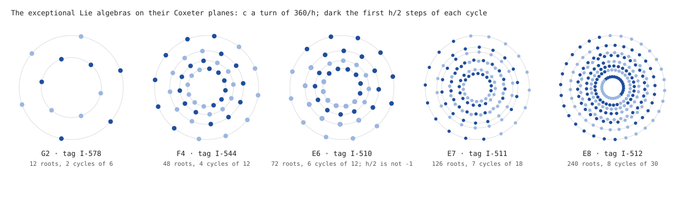

# The exceptional Lie algebras on their Coxeter planes

Generated by `svg/tools/lie.mjs`; every number is checked when the build runs. The author, 2026-10-13: the names E8, E6, E7, F4 (and G2) as `/A-Z0-9/` tag literals (proofs I-194). E8 alone, in both frames, is in [E8.md](E8.md).

| Name | Tag | Rank | Roots | Coxeter number h | Rings (cycles) | c^(h/2) = -1 |
|---|---|---|---|---|---|---|
| G2 | I-578 | 2 | 12 | 6 | 2 of 6 | yes |
| F4 | I-544 | 4 | 48 | 12 | 4 of 12 | yes |
| E6 | I-510 | 6 | 72 | 12 | 6 of 12 | no |
| E7 | I-511 | 7 | 126 | 18 | 7 of 18 | yes |
| E8 | I-512 | 8 | 240 | 30 | 8 of 30 | yes |

- **Built, not assumed.** Each root system comes from its simple roots by reflection; c is the product of the simple reflections; every root returns after h steps.
- **The plane.** Projected onto the plane of c's eigenvalues e^(±2πi/h), c is a turn of 360/h degrees and each cycle of h roots lies on one ring: rank rings in all.
- **Half a cycle.** In G2, F4, E7 and E8, h/2 steps send every root to its negative, so each ring is h/2 roots (dark) and their negatives (light). E6 is the exception: its Weyl group does not hold -1, and h/2 = 6 steps do not negate.
- **The tags.** E6, E7, E8 read in base 36 are I-510, I-511, I-512: 2^9 - 2, 2^9 - 1, 2^9.
